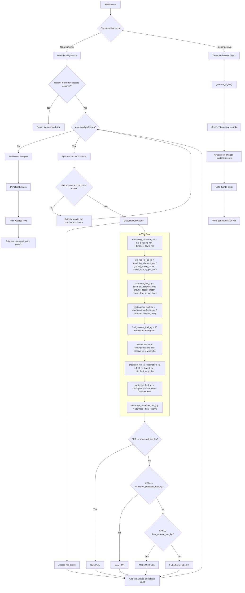

# AFRM Design

AFRM is an educational C++20 console prototype. It is not an operational
flight-planning system and is not approved aviation guidance. All data is
fictional and simulated.

The application has two main paths:

1. Load a CSV dataset and produce a fuel-status report.
2. Generate deterministic fictional flight data and write it to CSV.

The reporting path is implemented by:

- `src/AFRM.Core/CsvLoader.cpp`
- `src/AFRM.Core/Calculations.cpp`
- `src/AFRM.Core/Assessment.cpp`
- `src/AFRM/AFRM.cpp`



## Fuel calculation rules

The current implementation uses these simplified assumptions:

```text
remaining_distance_nm = trip_distance_nm - distance_flown_nm

trip_fuel_to_go_kg =
    remaining_distance_nm / ground_speed_knots
    * cruise_flow_kg_per_hour

alternate_fuel_kg =
    alternate_distance_nm / ground_speed_knots
    * cruise_flow_kg_per_hour

contingency_fuel_kg =
    max(
        0.05 * trip_fuel_to_go_kg,
        holding_flow_kg_per_hour * 5 / 60
    )

final_reserve_fuel_kg =
    holding_flow_kg_per_hour * 30 / 60

predicted_fuel_at_destination_kg =
    fuel_on_board_kg - trip_fuel_to_go_kg
```

Alternate fuel, contingency fuel and final reserve fuel are rounded up to
whole kilograms before the protection totals are calculated. Trip fuel to go
and predicted fuel at destination are not rounded.

## Status assessment

Statuses are evaluated in this order:

| Condition | Status |
|---|---|
| `PFD >= protected_fuel_kg` | `NOMINAL` |
| `PFD >= diversion_protected_fuel_kg` | `CAUTION` |
| `PFD >= final_reserve_fuel_kg` | `MINIMUM FUEL` |
| Otherwise | `FUEL EMERGENCY` |

Equality satisfies a threshold because the comparisons use `>=`.

The status logic is centralised in `assess_fuel_status()` in
`src/AFRM.Core/Assessment.cpp`.

## CSV loading

`load_flights_from_file()` opens the file and delegates to
`load_flights_from_stream()`.

The loader:

1. Checks the exact header.
2. Skips blank rows.
3. Splits each row into eight fields.
4. Parses the numeric fields.
5. Applies flight-record validation.
6. Stores valid records.
7. Stores rejected rows with their line numbers and reasons.
8. Continues processing after invalid rows.

The parser intentionally supports simple comma-separated fields only. Quoted
CSV fields and commas inside fields are not supported.

## Dataset generation

`generate_flights()` creates seven fixed boundary records followed by a
deterministic set of random records. The default seed is `20260601`.

Generated statuses are not stored in the CSV. Statuses are always calculated
later through `calculate_fuel()` and `assess_fuel_status()`.

The generator writes CSV through:

```cpp
write_flights_csv()
```